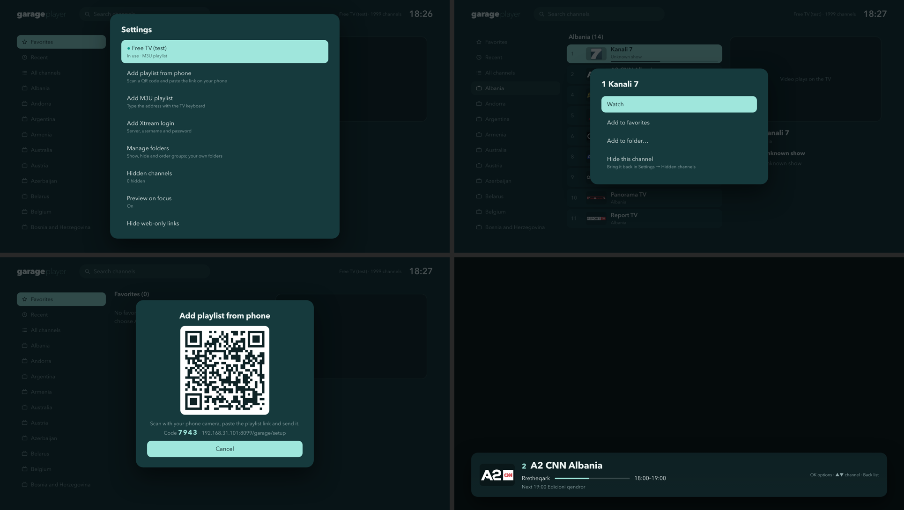

<p align="center">
  
</p>
<h1 align="center"><b>garage</b>player</h1>
<p align="center"><strong>A clean IPTV player for Samsung Tizen TVs.</strong></p>
<p align="center">M3U and Xtream playlists, EPG, favourites and PIN locks — add playlists straight from your phone.</p>
<p align="center">
  <a href="#features">Features</a> ·
  <a href="#remote-controls">Remote</a> ·
  <a href="#requirements">Requirements</a> ·
  <a href="#build-and-install">Build and install</a> ·
  <a href="#license">License</a>
</p>

Garage Player is the IPTV app from [**Garage Home**](https://github.com/zerodevb/garage-home), packaged on its own. It is designed for the remote, fast on older TVs and brings no ads or accounts. Garage Player does not include any channels; bring your own playlist.

<p align="center">
  
</p>
<p align="center">
  
</p>

## Features

- **Playlists.** M3U/M3U8 links and Xtream Codes logins, several playlists side by side.
- **Browse fast.** Folders (groups), favourites and search.
- **EPG.** XMLTV guides, gzip supported, matched to channels by id or name; now/next on the overlay.
- **Add from your phone.** Scan the QR code on the TV, paste the link on your phone, confirm on the TV.
- **PIN locks.** Lock playlists, folders or channels; adult groups are locked automatically.
- **Resets.** Clear favourites, locks or everything from Settings.

## Remote controls

| Key | Action |
| --- | --- |
| OK | Show the channel overlay |
| Hold OK | Channel options (favourite, lock) |
| Up / Down, CH +/− | Change channel |
| Back | Hide the info bar, then go back |

## Requirements

- A Samsung Tizen TV with **Developer Mode**, **Tizen Studio** (TV Extensions + Samsung Certificate Extension) and a Samsung **certificate profile**.
- Optional: **[Vetro](https://github.com/andrearicci93/vetro) with the Garage additions** — fork [zerodevb/vetro](https://github.com/zerodevb/vetro), branch `garage` (based on upstream [`e8553f2`](https://github.com/andrearicci93/vetro/commit/e8553f2)). It adds the phone QR inbox and a local proxy for playlists and guides that block TV apps. Without it, playlists that allow direct access still work.

## Build and install

```bash
cp garage.env.example garage.env     # set TV, CERT_DIR and KEYCHAIN_SERVICE
(cd tools/signing && npm ci --ignore-scripts)
./build-player.sh
```

`garage.env` is git-ignored. Signing passwords are read from the macOS Keychain. Set `window.GARAGE_CONFIG = {tvIp: '…'}` to enable the phone QR code, and `window.GP_PROXY` to use a different proxy.

Open `player/index.html` in a desktop browser for a preview.

## Compatibility

Tested on a **Samsung Q60A (QE75Q60AAUXZT, Tizen 6, firmware T-NKLADEUC-2030.1)**. Other Tizen 6+ TVs should work; please report results in an issue.

## Credits

[Vetro](https://github.com/andrearicci93/vetro) signing tools (MIT), [qrcode-generator](https://github.com/kazuhikoarase/qrcode-generator) (MIT), [pako](https://github.com/nodeca/pako) (MIT).

## License

[PolyForm Noncommercial 1.0.0](LICENSE). Free to use, modify and share for any noncommercial purpose; **selling it or using it commercially is not allowed** without permission. Bundled libraries keep their own MIT licenses.

<p align="center"><br>Powered by <a href="https://thegaragedevs.com"><b>TheGarageDevs.com</b></a></p>
